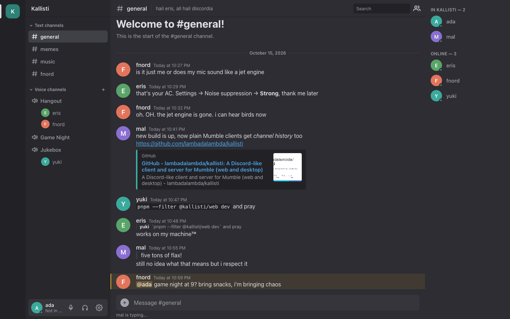

# Kallisti

Voice and text chat on top of Mumble, with a Discord-like interface. Web first.
https://kallisti.chat



- `packages/protocol`: Mumble protocol (framing, protobuf codec, state, voice packets)
- `apps/web`: Svelte web client (chat, voice, settings)
- `server`: Go server: web app, accounts, text channels and a built-in Mumble
  server (Mumble clients and web clients in one place)
- `packages/devtools`: dev scripts (smoke test, voice bot)

## Deployment

Kallisti runs in one of two ways:

- **Built-in server** (recommended): Kallisti is the Mumble server. Web users,
  the desktop app and normal Mumble clients all connect to it, and every
  feature works.
- **In front of an existing Murmur**: Kallisti adds the web app, accounts and
  text channels; voice stays on your Murmur server and its Mumble users keep
  everything they have. Some features need the built-in server (see below).

Both need a domain with HTTPS: browsers allow the microphone only on secure
pages. The quickest start, with Docker and the built-in server:

```sh
printf 'DOMAIN=chat.example.org\nSUPERUSER_PASSWORD=%s\n' "$(openssl rand -hex 16)" > deploy/.env
docker compose -f deploy/compose.yml up -d --remove-orphans
```

- [Installing with Docker or Podman](docs/install-docker.md) (both ways)
- [Installing without containers](docs/install-binary.md) (the program,
  systemd, Caddy)
- [Configuration](docs/configuration.md): all settings
- [Updating](docs/updating.md), with upgrade notes
- [Backups](docs/backups.md)

### What works where

| | Built-in | Murmur |
|---|:-:|:-:|
| Voice in the browser and the desktop app, avatars, private messages | ✓ | ✓ |
| Text channels with history, uploads, mentions, replies, search | ✓ | ✓ |
| Edit and delete your own messages; remembered read state | ✓ | ✓ |
| Ban list and registered users in the web app (with Mumble rights) | ✓ | ✓ |
| Lobby: users join voice channels on purpose | ✓ | – |
| Manage text channels and topics in the app (admins, moderators) | ✓ | – (env) |
| Moderator role; moderators delete others' messages | ✓ | – |
| Stored voice channel chats | ✓ | – |
| Text channels for Mumble clients (mirrors) | ✓ | – |
| Guest accounts; reactions for guests | ✓ | – |
| Log in as SuperUser with the "Log in" tab | ✓ | – |

### For people with Mumble clients

A Kallisti server is a normal Mumble server for them: they keep their
client (Mumble 1.3 or newer; older clients have no Opus).

**With the built-in server**

- What they know works: voice channels, temporary and linked channels,
  whispering and shouting, listening to other channels, positional audio,
  comments and avatars, registering with their certificate, private and
  channel messages, rights (ACLs and groups), and for admins bans and the
  list of registered users.
- Web and desktop users are normal users for them, with their avatars.
- Text channels appear as channels under "Text channels". Entering one
  shows the messages they missed (up to 20); what they write there goes
  into the text channel. Nobody can talk there.
- The top channel is a lobby: to talk, they join a voice channel.
- What they write in a voice channel is stored, so web users see it later
  in that channel's chat (and in search). Pictures that registered users
  send are kept as attachments; files from web users arrive as links, and
  replies with a short quote in front.
- The names of Kallisti accounts are theirs only: a Mumble guest cannot use
  them. Moderators that admins make in the web app have their rights in
  Mumble too (kick, ban, move, change channels).
- What they do not see: reactions, later edits and deletions, typing,
  link previews, formatting (they get the plain text) and read state.
- Not there: plugin data between clients (for example game positions
  shared by Mumble plugins) and menu entries that server scripts add
  through Murmur's Ice interface.

**In front of an existing Murmur**, nothing changes for them: Murmur stays
their server. Web users are normal Mumble users there (accounts are
registered users); text channels and their history are for web users only.

## Desktop app

`apps/desktop` is a Tauri app around the same web client. A small bridge in
the app (Rust) connects it straight to any Mumble server, without the
Kallisti server; text channels, uploads and accounts need the Kallisti server
and are not shown there. Needs Rust.

```sh
pnpm --filter @kallisti/desktop dev                  # window with the Vite dev server
pnpm --filter @kallisti/desktop build --bundles app  # Kallisti.app
```

## Development

Needs Node with pnpm, Go and bun.

```sh
pnpm install
pnpm test        # TypeScript and Go tests

# Server: web clients on port 8080, Mumble clients on 64738
cd server
ALLOWED_ORIGINS='*' go run ./cmd/server

# Web client on http://localhost:5173 (server defaults to port 8080)
pnpm --filter @kallisti/web dev
```

Settings: see [configuration](docs/configuration.md).

The official Mumble client in podman, for the server tests:
`KALLISTI_OFFICIAL_CLIENT=1 go test ./internal/mumbled` (see
`packages/devtools/mumble-client`).

Dev scripts (with a running bridge):

```sh
pnpm --filter @kallisti/devtools smoke ws://127.0.0.1:8080
pnpm --filter @kallisti/devtools voicebot tone.opus ws://127.0.0.1:8080
```

## License

Public domain: [the Unlicense](LICENSE). The web app includes RNNoise and
DeepFilterNet3 (for noise suppression) under their own licenses: see
[third-party-notices.txt](apps/web/public/third-party-notices.txt), which the
built app also serves.
